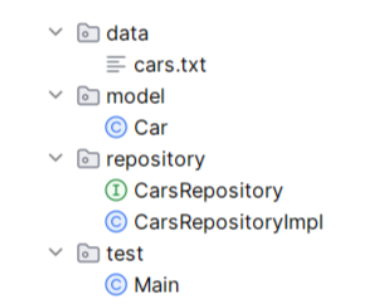

Домашнее задание по теме «Java Collections. Stream API»

✅ Формулировка задания

Реализовать класс Car (Автомобиль)

Поля класса:

number — номер автомобиля
model — модель
color — цвет
mileage — пробег
cost — стоимость
Методы:

Конструктор
Геттеры и сеттеры
Переопределённые методы equals, hashCode, toString

Проверить работу в классе Main, методе main

Создать объект Java Collections со списком автомобилей

Использовать Java Stream API для выполнения следующих задач:

Номера всех автомобилей, имеющих заданный цвет или нулевой пробег.
Количество уникальных моделей в ценовом диапазоне от n до m.
Вывести цвет автомобиля с минимальной стоимостью.
Средняя стоимость заданной модели.

📥 Входные данные
Формат данных в файле cars.txt:

[НОМЕР_АВТОМОБИЛЯ][МОДЕЛЬ][ЦВЕТ][ПРОБЕГ][ЦЕНА]
a123me|Mercedes|White|0|8300000
b873of|Volga|Black|0|673000
w487mn|Lexus|Grey|76000|900000
p987hj|Volga|Red|610|704340
c987ss|Toyota|White|254000|761000
o983op|Toyota|Black|698000|740000
p146op|BMW|White|271000|850000
u893ii|Toyota|Purple|210900|440000
l097df|Toyota|Black|108000|780000
y876wd|Toyota|Black|160000|1000000

📤 Выходные данные
Пример вывода в консоль:

Автомобили в базе:
Number Model Color Mileage Cost
a123me Mercedes White 0 8300000
b873of Volga Black 0 673000
...
Номера автомобилей по цвету или пробегу: a123me b873of o983op l097df y876wd
Уникальные автомобили: 4 шт.
Цвет автомобиля с минимальной стоимостью: Purple
Средняя стоимость модели Toyota: 744200,00
Средняя стоимость модели Volvo: 0,00

Структура проекта

Требования к реализации

Реализация должна быть в отдельной ветке Git: homeworks/homework011
При каждом коммите должно быть описано, что было сделано
Должен быть создан .gitignore в корне проекта
Репозиторий должен быть опубликован на GitHub для проверки
Дополнительно:

Реализовать ввод и вывод программы в файл *.txt
Вынести логику работы с автомобилем в папку repository: интерфейс CarsRepository и его реализацию CarsRepositoryImpl

Реализовано:

